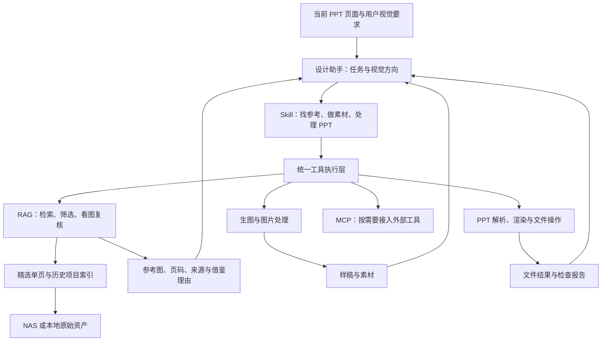

# PPT 视觉生产 Agent 与 RAG 实施规划

日期：2026-11-19（北京时间）  
状态：规划草案；本次只新增文档，未修改、安装或启用产品功能。  
适用项目：环中 AIStudio，`/Users/congrong/Documents/AI平台`。

## 1. 目标与边界

### 用户已明确的方向

- 主要业务是 PPT 视觉美化，客户通常已确定内容。
- 优先提高找参考效率、生图质量与制作效率，并能调用工具处理 PPT 文件。
- 希望增加 Agent、MCP、Skills 和 RAG，逐步使用历史项目和人工精选参考。
- 探索阶段支持与设计师一起发散和选择方向。
- 所有交付 PPT 必须符合工作区的自由编辑要求。

### 本文建议，尚未视为用户选型决定

- 先完成“单页设计助手”，再扩大为批量与整稿能力。
- 原始文件可留在现有 NAS 或本地目录；索引和缩略图先放本机；Obsidian 后续作为可选笔记来源。
- 先用图片描述的文字向量、关键词和结构筛选实现混合检索，依据评测结果决定是否增加图片向量。
- 一名设计助手按需执行不同 Skills，复用同一组业务工具。
- 数据库、Embedding 模型、MCP 服务商暂不定死，按样本评测、实际运行平台及模型接口兼容性确定。

首个产品目标：

> 导入客户原稿或单页 → 选择页面 → 提出视觉要求 → 找到适配参考并查看理由 → 确认借鉴关系 → 准备生图任务或调用已有图片工具 → 保留结果与来源。

客户定稿的文字、数字和事实作为任务约束保存，默认不改写。“保留内容”是执行规则，不是对文本或对象加编辑锁。

## 2. 对双钻模型的实际取舍

| 阶段 | 在本业务中的用法 | 可验收产物 |
| --- | --- | --- |
| 探索 | 看原稿、检索版式与视觉参考、比较方向 | 参考候选和适用理由 |
| 定义 | 确定配色、字体、材质、装饰密度、留白和参考用途 | 可编辑的视觉方向记录 |
| 设计 | 先做代表性样页或素材，再按确认方向延展 | 样稿、素材、单页结果 |
| 验证 | 对照客户内容、视觉方向和交付规格检查并修订 | 差异与问题清单、交付结果 |

简单裁图、换图等任务可以直接调用工具；不强制每个操作都经过完整双钻流程。

## 3. 源码现状与可复用能力

以下为本次源码检查结果，不等于已在安装版桌面窗口验收。

| 能力 | 源码位置 | 当前结论 |
| --- | --- | --- |
| 图片 AI 入库分析 | `src/lib/library-import-analysis.ts` | 已有标题、描述、标签、可见文字和复用提示词分析；可扩展 PPT 专用字段 |
| 案例库 | `src/lib/case-library-store.ts`、`src/components/ReferenceLibrary.tsx` | 已有案例资产、标签、来源和图像展示；优先沿用现有入口 |
| 资产搜索 | `src/lib/asset-indexing.ts`、`src/app/api/asset-search/route.ts` | 已有关键词打分和条件筛选，尚不是完整向量检索 |
| NAS 与资料索引 | `src/lib/knowledge-hub-store.ts`、`src/lib/knowledge-hub-sync.ts` | 已有文件扫描与索引；PPT 逐页理解和知识检索仍需建设 |
| Agent 生图接口 | `src/app/api/agent-chat/route.ts` | 主要解析生成标记后生图；未见通用结构化工具循环 |
| 主界面对话 | `src/app/page.tsx`、`src/app/api/chat/route.ts` | 当前主页面未直接调用上述 Agent 接口；普通对话默认只使用本次消息 |
| 模型配置 | `src/lib/model-settings.ts` | 有 Embedding 等类别；不代表已完成向量索引或工具调用验证 |
| PPT 导入、渲染与解析 | `src/app/api/ppt-workshop/import/route.ts`、`src/features/editable-ppt/lib/import.ts` | 有可复用基础；复杂对象、母版、组合与渲染保真需要样本验证 |
| 可编辑 PPT 导出 | `src/features/editable-ppt/lib/export.ts` | 有文本与形状导出，但仍有 `fit: "shrink"`，接入交付前必须修正并验证 |
| 基础工作台导出 | `src/app/api/ppt-workshop/export/route.ts` | 此路径将整页图片放入 PPTX，只能标注图片版预览，不能视作可编辑交付 |
| 文字核验 | `src/app/api/ppt-workshop/verify-text/route.ts` | 未解析到原文时返回通过；解析失败时用相似度兜底，不能承担严格验收 |
| 批量任务 | `src/lib/batch-module/` | 有任务、页状态和恢复相关结构；开发时验证可复用范围 |

旧版 Agent 工作台和 PPT V2 文档只作为历史背景；以当前源码和用户正在使用的安装版实际行为为准。

## 4. 能力结构

工具执行层由程序负责参数校验、用户与项目范围、日志、取消、结果保存和费用边界。Skills 提供方法与调用规则；MCP 提供外部连接；RAG 提供有来源的设计依据。它们共用任务状态，不各自再建一套重复资产系统。

## 5. 分阶段交付

### 阶段 0：核实现状，建立小样本与对比基线

工作内容：

1. 核实 `/Applications/环中AIStudio.app` 的实际运行路径、加载目录和当前可见功能，记录入口；保留进行中任务和输入。
2. 建立“内部工具、模型、PPT 解析与渲染”的能力清单，区分已验证、待验证和未实现。
3. 挑选 5～10 个有代表性的项目中的 50～100 页，再配 30～50 张精选参考。首批使用公开、自有或明确允许处理的资料。
4. 建立约 20 个真实检索问题，包含版式检索、语义检索、混合条件、相似画面和库内没有答案的情况。
5. 记录当前找参考的耗时和结果；记录典型生图任务的采用情况及实际消耗，作为后续比较基线。
6. 验证候选模型的看图、中文理解、结构化工具调用与 Embedding 接口。普通对话通畅不能代替上述验证。

产物：能力清单、样本清单、检索问题集、基线记录、第一期工具清单。

完成标准：能说明每项现成功能的真实状态；样本有明确来源；可以用同一组任务比较新旧效果。

### 阶段 1：单页设计助手 + 第一版 RAG

用户入口：沿用现有案例库和画布，增加“为这一页找参考”，支持 PPT 导入后选择单页，也允许先上传单页图片。

工作内容：

1. PPT 拆页、页面预览和文本提取复用现有实现，增加稳定项目 ID、页 ID 和源文件关系。图片页面用 OCR 辅助，区分原生提取与识别结果。
2. 扩展图片分析，形成 PPT 专用页面资料，支持人工修正。
3. 建立可重复的入库流程：去重 → 保存缩略图 → 分析 → 生成向量 → 建索引。显示等待、失败和已完成状态。
4. 做关键词、结构条件与文字向量的混合检索；从候选中选取少量页面交给视觉模型复核，实际传入图片而非只有标签。
5. 做最小工具执行循环：读取选中页面、搜索参考、读取参考详情、保存用户选择。提供实际调用记录和停止入口。
6. 增加第一项 Skill：“为当前 PPT 页面寻找视觉参考”。说明如何读取内容密度、查找不同借鉴方向、判断不适配和返回来源。
7. 结果卡展示参考图、所属项目、页码、推荐理由、适合借鉴之处。未找到时明确说明，允许放宽条件重查。
8. 保存参考用途：版式、配色、材质、字体、主视觉等；供后续生成使用。

第一期完成后，用户可以和助手讨论参考、保留选择、修改检索方向。新工具执行链不依赖聊天文本中的生成标记；直接生图仍保留原有使用方式。

### 阶段 2：参考驱动生图 + 最小 MCP 接入

工作内容：

1. 将当前生图与图片处理服务包装成统一工具，沿用现有模型配置和实际可用的能力。
2. 增加 Skill：“PPT 背景与主视觉制作”。按背景、主视觉、透明素材分别组织要求，明确文字留白、位置、比例和保留对象。
3. 保存视觉方向记录与参考分工。生成请求包含必要参考、目标用途和禁止改变项，可查看实际提交内容。
4. 记录模型、参考图、提示词版本、规格、耗时、失败原因、实际费用或费用未知状态，以及用户是否采用。
5. 样稿确认后支持延展；局部修改与整张重做分开；重试先核对已有任务与结果，减少重复计费。
6. 实现一个可管理的 MCP 连接适配器，并接通一个确实有用的服务。优先验证外部参考检索或图片处理，具体服务以真实接口和能力测试为准。
7. MCP 与内部工具使用相同参数校验、任务日志和权限范围，外部连接失败不能影响内部库检索。

MCP 是本轮范围内的明确交付项；先接通一个真实服务验证价值，再按生产需要增加连接。网页能打开不等于能稳定取得参考图原图，检索能力和下载能力分开验收。

完成标准：一页能完成“内部检索 → 必要时外部补充 → 选择参考 → 生成素材 → 图片处理 → 保存”的流程；可比较采用效果与消耗。

### 阶段 3：实用 PPT 文件工具与交付检查

按操作风险与复杂度逐项接入：

1. 只读工具：整稿缩略图、逐页渲染、文字与图片提取、尺寸与字体清单、原稿和修改稿对照。
2. 明确操作：选页导出、图片替换、背景插入、导出 PDF。复杂合并和拆分需验证母版、关系、字体和备注的保留，再逐步加入。
3. 增加 Skill：“PPT 文件整理与交付检查”。所有写文件操作另存到明确输出位置，不覆盖客户原稿。
4. 修复导出自动缩字；普通固定文本框显式 `a:noAutofit`，确需随内容扩展的文本框使用 `a:spAutoFit`。检查幻灯片、组内、表格、版式、母版与主题默认值。
5. 不添加限制组合、取消组合、选择、移动、缩放、旋转或文字编辑的锁；图片可保留纵横比锁。避免依赖不能组合的占位符。
6. 重做严格文本核验：原生文本优先做确定性比较；OCR 和视觉检查作为补充。分别呈现通过、失败、待人工确认、跳过和执行错误，不能把缺少原文或模型异常显示为通过。
7. 客户数字、单位、标点、表格与图表数据单独核对；不使用去标点或粗略相似度替代严格保留。允许的格式变化需有明确规则。
8. 每份交付提供结构检查与渲染结果；不支持的对象明确交回人工，不将含文字整页栅格化后声称可编辑。
9. 用测试副本放大代表性文字，测试组合/取消组合、保存再打开。可复用 `/Users/congrong/Documents/ChatGPT/计划书排版/tools/pptx_editability.py`；修复必须指定独立输出和报告。未完成 PowerPoint 原生测试时如实标明。

任意复杂 PPT 的无损自动重排不是本阶段默认承诺。需要按具体对象与操作扩展能力。

### 阶段 4：扩展知识库与团队使用

- 根据第一批效果扩充到 200～500 页，之后逐批扩大；人工精选与普通素材区分。
- 增加图片或多模态向量检索前，对同一组任务验证是否改善版式与视觉相似检索。
- 支持批量分析、断点恢复、内容指纹去重、增量更新和索引重建。
- 记录参考是否被选择、生成结果是否采用、人工纠正与原因；不直接把所有点击都当作高质量反馈。
- 增加项目复盘与设计方法笔记，可读取 Obsidian Markdown；原图和原稿继续保持来源关系。
- 多人需要共享检索时，再部署单一共享索引服务；客户端通过服务访问，不通过 SMB 同时写同一个本地数据库文件。

## 6. 单页知识资料的最小字段

| 类型 | 字段与用途 |
| --- | --- |
| 来源 | 资产 ID、项目 ID、页 ID、页码、原文件相对位置、来源库、访问范围 |
| 版本 | 内容指纹、原文件修订、分析模型及版本、Embedding 模型和维度、索引版本 |
| 内容 | 标题、原生文字、OCR、关键数字、页面功能、板块数量与内容密度 |
| 视觉 | 版式、色彩、背景、字体特征、图片占比、图表类型、装饰密度 |
| 经验 | 值得借鉴什么、适合什么内容、不适合什么情况、人工点评 |
| 质量 | 人工精选状态、AI 与人工字段来源、识别信心、分析状态 |
| 使用 | 项目中被选用的参考关系、采用反馈、最后使用时间 |

固定分类采用小词表，允许补充自由描述；人工修改优先保留，不被重新分析覆盖。不要让 AI 从图片猜测客户、作者、版权、保密等级或真实文件权限。

文件迁移通过“资料源 ID + 相对位置 + 内容指纹”关联，实际打开路径由当前资料源配置解析。移动、更新、删除文件时维护索引和失效状态。不同 Embedding 版本的向量不能直接混用，切换模型需要独立重建与验证。

## 7. 首批工具与 Skills

### 内部工具建议

| 工具 | 输入与结果 | 首次接入阶段 |
| --- | --- | --- |
| 读取页面 | 项目/页面 ID → 图片、文字、来源与解析状态 | 阶段 1 |
| 搜索参考 | 主题、页面结构、风格、筛选范围 → 候选与分数 | 阶段 1 |
| 读取参考 | 参考 ID → 图片、分析、项目与页码 | 阶段 1 |
| 保存参考选择 | 页面 ID、参考 ID、借鉴用途 → 持久化记录 | 阶段 1 |
| 生成背景/主视觉 | 视觉方向、参考、规格 → 生成任务 ID 和状态 | 阶段 2 |
| 处理图片 | 素材 ID、具体操作 → 新素材和处理记录 | 阶段 2 |
| 渲染/检查 PPT | 文件 ID、页范围 → 预览和检查结果 | 阶段 3 |
| 执行限定文件操作 | 文件 ID、明确操作 → 独立输出与差异报告 | 阶段 3 |

第一期先做结构化工具调用与运行记录，初始限制每轮约 8 次工具操作，超限保留进度并允许继续。所有输入在程序侧校验项目与资料范围；资料正文和图片中的文字只作为材料，不具有发起工具操作的授权。

长期任务从聊天连接中分离，以任务 ID 查询状态。记录排队、运行、成功、失败、取消与结果未知；服务商未提供查询能力时，不把请求中断直接当失败重新扣费。

### 首批 Skills

1. 为当前页面寻找视觉参考。
2. 从参考中提炼可修改的视觉方向。
3. 制作 PPT 背景、主视觉与素材。
4. 整理 PPT 文件并检查交付。

Skills 保存在平台可读取、可版本化的位置，由平台加载；不依赖某个开发助手的本机安装目录。第一期不需要技能市场或多个角色之间的复杂调度。

## 8. 存储与服务建议

- 原始 PPT、PDF 和图片：优先沿用现有 NAS 或本地文件，不为入库复制整套项目。
- 分析与元数据：先使用适合现有桌面运行方式的本地存储，业务资料结构与向量引擎解耦。
- 缩略图与预览：本机受限缓存，支持清理与重建；清缓存不删除原图、项目或人工点评。
- 检索索引：首批规模优先简单可维护的实现，验证后决定嵌入式向量引擎或独立服务。避免为几百页资料提前增加常驻服务负担。
- NAS 不必承担视觉模型推理；电脑或已配置模型服务负责分析。NAS 离线时仍可检索已缓存资料，打开原稿时明确显示连接情况。
- Obsidian：可选的人类知识编辑入口，可增量读取 Markdown 与附件关系；它不承担平台的完整任务队列或向量检索后台。
- 项目资料和检索结果先按访问范围过滤，再提交给模型；发往模型的材料范围跟随任务配置。

## 9. 建议验收指标

以下是试点目标，不是已达到的性能或质量承诺。建立基线后可调整，但不能仅凭演示对话或编译通过验收。

| 维度 | 验收方法与建议目标 |
| --- | --- |
| 来源可追溯 | 试点返回结果的项目、页码和原稿关系全部正确；资料源离线时准确显示状态 |
| 参考有效性 | 在库内确有参考的测试问题中，至少 80% 的问题能在前 10 项找到 3 个设计师认可的参考；另测库外问题能否正确说明未找到 |
| 找参考效率 | 同类任务从提出要求到选定参考的中位耗时，较人工基线下降约 40%；记录网络与模型耗时 |
| 视觉检索增益 | 单独比较关键词、文字向量混合、多模态方案，不凭主观印象决定新增模型 |
| 生成效果 | 用相同页面、相近生成次数和预算记录可用率、采用率与修改量；目标是采用率提高或每个采用结果所需生成次数下降 |
| 费用 | 展示真实调用与生成次数；能查到费用才显示金额，未知不显示为零；自动修订有数量和预算范围 |
| 可恢复性 | 停止、断网、刷新、重启后保留已完成结果与来源；不重复启动同一已完成操作 |
| 内容保留 | 指定核验样本的文字、数字和数据无未经允许的改变；跳过、错误、人工待核验单独展示 |
| 编辑性 | 无自动缩字与禁止编辑锁；测试副本放大文字及组合/取消组合、保存重开；记录原生应用测试情况 |

开发调试可先用小样本；至少保留部分查询与页面作为未参与调优的验收样本，避免只对展示案例有效。新增付费生成和批量分析测试需在明确的任务处理范围与费用设置内执行，规划本身不触发这些操作。

## 10. 从下一次开发开始的具体顺序

1. 核实当前安装版的运行目录与页面入口，补齐能力清单；不提前重建整套工作台。
2. 定义最小页面资料、参考用途、工具输入输出与任务记录；兼容已有案例和图片资产。
3. 新增单页入口：选中原稿后可以“找参考”，暂用现有关键词检索验证真实工具执行。
4. 扩展 PPT 页面分析与小样本入库，再接文字向量混合检索；与原检索跑同一组查询。
5. 加上看图复核、来源卡片和参考选择保存，交付第一条可用流程。
6. 紧接着接通生图工具、视觉方向 Skill 和一个 MCP 服务，验证生产价值。
7. PPT 写入工具接入前，完成自动缩字和文字核验的已知问题修复，再逐项扩展文件操作。

每个实现批次都要完成适当的类型、构建和业务检查，更新用户正在使用的 `/Applications/环中AIStudio.app` 并在实际桌面窗口验证；必要重启前告知并检查任务与输入。按现有版本维护，不额外复制整套应用、不擅自提交用户修改，不因本规划提前制作安装包。

## 11. 启动所需信息与当前交付状态

当前已经足以开始只读核验、数据结构和工具执行基础开发，不必先确定整个 NAS 目录结构或 Obsidian 方案。

进入真实资料入库前需要明确：首批允许处理的项目/参考目录。进入真实模型测试前需要确认适用的已配置模型能力和材料处理范围，并设置分析/生成数量或预算。若资料尚未选定，先用公开或自制样本推进。

当前交付仅为规划文档；尚未接入 MCP、向量检索、新 Skills 或新的 Agent 执行功能，也未更新本机应用。
