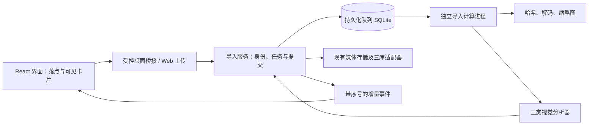

# 三库图片智能导入功能设计

日期：2026-11-16（北京时间）
状态：功能与工程设计，尚未接入正式应用。交互原型：`prototypes/library-import.html`。原型的保存、AI 与失败均为模拟，不上传图片、不调用模型、不修改真实库；刷新不保留原型数据。

## 1. 目标与范围

提示词库、字体库、案例中心统一支持单张及批量图片拖拽；先安全收录，再后台完成文字提取、命名、分类、标签、设计分析和搜索资料补全。用户可以同时聊天、创作、移动画布、检索和编辑已有卡片。

首版交付包含统一导入入口、持久化队列、三类分析器、批次任务面板、局部更新、人工编辑保护、失败重试、取消剩余分析、撤销本批新增及重启恢复。沿用现有单层分组和案例多分类，不增加新的一级工作区。

首版不自动裁切整张合集为多张作品，不识别并安装字体文件，不按视觉相似度自动合并作品。以图搜图、向量检索、自动多图案例合并放在后续阶段。现有案例 ZIP、资源包和历史收录入口保留，接入时必须防止再次触发旧整理流程。

## 2. 现有实现与约束

以下为本次阅读工作区源码得到的现状，不代表已经核实当前安装版加载的构建：

| 位置 | 现状 | 改造方向 |
| --- | --- | --- |
| `src/components/FontLibrary.tsx` | 支持批量拖入，前端循环提交，以 `busy` 管理上传 | 接入统一导入控制器，允许继续追加与切页，不锁定整个库 |
| `src/lib/font-library-organizer.ts` | 服务进程内存队列，逐图分析，模型路由已接入 | 抽取字体分析器，接入持久化调度，取消双队列 |
| `src/lib/font-library-store.ts` | 内容寻址图片；JSON 索引；版本冲突保护；可撤销整理 | 保留已有卡片和资料，补充字段来源、幂等标记与事务补偿 |
| `src/components/ReferenceLibrary.tsx` | 批量图片/ZIP 导入、分页和分类 | 接入任务中心和增量结果，保留详情草稿与选择 |
| `src/lib/case-library-store.ts` | 原图 SHA-256 去重；JSON 索引；同图重传可能恢复回收站记录 | 显式区分新增、复用、恢复；撤销只作用于本批确实新增的记录 |
| `src/components/PromptManager.tsx` | 正文卡片，预览、分组、标签 | 增加待分析图片草稿和导入状态，空正文禁止“采用提示词” |
| `src/app/api/prompts/route.ts` | 新增要求非空正文及项目 ID | 新增专用导入草稿适配层，不塞入占位正文，不伪造项目 |
| `electron/preload.ts` | 已有受控桌面 API，无导入文件桥接 | 增加原生文件选择/拖入文件解析与导入凭证；仅暴露窄接口 |
| `electron/main.ts` | Next standalone 在 utility process 中运行 | 为导入增加独立计算进程与生命周期管理，不阻塞 Electron 主进程 |

目前字体上传接受 JPG/PNG/WebP，25 MiB；案例接受 JPG/PNG/WebP/AVIF，40 MiB，像素上限 8000 万。首版统一直接图片入口采用 JPG/PNG/WebP、25 MiB、8000 万像素；UI 明示限制。案例现有 AVIF/40 MiB 导入继续走兼容入口，后续实测再统一扩展。按实际文件签名检查，不只看扩展名。批量接收逐项报告拒绝原因，不因一个坏文件拒绝整批。

## 3. 产品交互

### 3.1 入口与落点

| 落点 | 默认行为 | 拖入提示 |
| --- | --- | --- |
| 库页面内容区 | 每图一张新卡片，目标为当前库/当前真实分类 | “松开导入到字体库 · 几何科技” |
| 左侧指定分类 | 按悬停分类入库 | “导入到几何科技，保留此分类” |
| 详情中的“添加图片”区域 | 追加到当前卡片 | “为这张卡片添加 3 张图片” |
| 卡片封面普通区域 | 不直接覆盖，显示追加入口 | “添加到此卡片”；替换封面必须明确选择 |
| 收藏、最近使用、搜索结果、回收站等虚拟视图 | 不将虚拟视图作为分类；使用明确的目标分类或未分组 | 显示真实目的地，导入后用“查看本批”定位 |

首版约定：提示词和案例附件保留同卡图片关系，字体继续区分成品封面与参考图。拖到现有卡片的追加区域才进入附件模式，避免普通批量拖入意外合并。封面替换为独立动作，可撤销，不删除旧图片文件。

拖拽使用统一 drop owner 判定：详情追加区域 > 分类 > 库内容区。只接管系统文件拖拽；内部卡片拖动不触发上传。拖入嵌套区域不闪烁；离开窗口、按 Esc 或 drop 后清除高亮。文件选择与粘贴复用相同管线。文件夹首版提示使用多选图片，不静默忽略目录。

### 3.2 正常导入

1. 松手立即展示“已接收 N 个文件，正在检查”，轻量占位卡标注“尚未保存”。不先读取全部文件内容。
2. 每图独立校验、流式持久化原图。确认文件完成与记录可恢复后，显示“已保存”。
3. 当前可见项优先准备缩略图，画面按原比例 contain 展示。缩略图失败不删除原图。
4. 后台开始分析。临时标题用原文件名，AI 结果回来后按字段保护规则补齐。
5. 可继续导入、切页与编辑。列表位置默认按导入序号稳定，结果回来不自动重新排序或跳走。
6. 完成后提供批次摘要与“查看本批”，不用持续弹出逐图 toast。

首屏只挂载可见卡片和少量预读范围。任务列表分页/虚拟滚动。文件总数通过批量登记得到，不为每个文件同步创建完整 DOM。

### 3.3 全局任务入口与面板

复用应用顶栏工具区域新增“导入 18/24”轻量入口；任意工作区可见。点击打开右侧任务面板，宽屏约 360px、窄屏使用已有可访问抽屉；打开与关闭保留焦点和主工作区输入。

面板分开显示：

- 收录：已保存 / 总数、重复、拒绝、保存失败；按实际字节显示文件复制进度，不能拿文件个数冒充字节进度。
- 整理：完成、等待、处理中、需处理。不能合成一个掩盖阶段的百分比；未知总量使用不定进度。
- 操作：查看本批、暂停后续整理、继续、重试失败、取消剩余整理、撤销本批新增。
- 每图：缩略图、原名/新名、真实状态、简短错误和对应操作。显示处理中模型，不暴露密钥和内部异常堆栈。

关闭面板只收起界面；暂停只停止新启动的分析，已在执行的请求正常结束，原图保存继续。取消剩余分析保留原图，可手动继续。退出应用不承诺后台继续工作；已安全保存的任务下次启动恢复。尚未获得持久化来源的浏览器 File 必须提示重新选择。

### 3.4 卡片与编辑

缩略图和标题下保留一行低干扰状态；失败用文字加图标表达，不只靠颜色。成功后恢复普通卡片，详情页保留分析来源和时间。低置信度项显示“文字待确认”等具体原因。

用户打开详情即可编辑，AI 运行不锁表单。提交期间只禁用当前保存按钮。结果仅对未修改且由系统管理的字段自动生效；冲突字段保存为建议，显示“有新的分析建议”，由用户应用。前端未保存草稿也不能被刷新替换。

提示词为空时展示“提示词整理中”，仍可用图片作参考，不能把空内容插入创作输入。保留项目归属约束：无当前项目时，图片以全局导入草稿保存，后续采用或保存到项目再绑定，不偷偷创建项目。

## 4. 三类自动整理

| 类型 | 共用字段外的结果 | 内容使用 |
| --- | --- | --- |
| 提示词 | OCR、主体、构图、色彩、光线、材质、风格、可复用指令 | 区分图中摘录、嵌入参数与 AI 反推；原文与建议独立保存 |
| 字体 | 示例文字、字形结构、笔画、字重、倾斜、空间关系、表面材质、用途、风格复用指令 | 沿用已有字体资料，不根据图片猜定商业字体名称 |
| 案例 | 设计类型、行业线索、版式、信息层级、视觉焦点、配色、可借鉴方法 | 品牌/作者/来源不可靠时留空，不将推断写成事实 |

共用输出：建议标题、摘要、候选分类 ID、标签、逐字段证据/不确定性、模型与分析规则版本。JSON schema 服务端校验，限定长度、数组数量与枚举。模型只提建议，由服务端白名单决定可写字段，不让模型指定文件路径或任意分类 ID。

命名格式遵循内容：提示词“主体/用途 · 主要风格”，字体“可靠示例文字 · 字形风格”，案例“设计类型 · 主要视觉特征”。避免堆满形容词；标题过长只在显示层省略，原文件名单独保存。

分组优先级：明确拖入分类 > 既有人工分类 > 匹配当前有效分类 > 未分组＋建议。AI 不默认创建新分类。字体现有八类风格作为分析词表，不强制生成八个实际文件夹。案例可以多分类，但自动新增归属只在用户启用后进行。

置信度只作为模型自报信号，不当作经过校准的真实概率。复杂艺术字逐字不确定时保留空缺或建议；沿用当前字体 OCR 门槛作为初始兼容策略，并用标注样本验收，不承诺某个分数等于准确率。

提示词来源放详情的来源字段，例如“AI 反推”；可复用指令正文不反复插入来源免责声明，保持现有字体复用习惯。文件嵌入参数、OCR 原文、AI 反推与用户正文永远分别存储。

## 5. 流畅性与资源调度

### 5.1 进程划分



Electron 主进程仅协调生命周期与 IPC，不能执行整批同步哈希、图片解码或大 JSON 序列化。Next API 负责快速接收/查询/提交，不在一个 HTTP 请求或 `after()` 中承载整个批次。导入重计算放独立进程；其崩溃不会退出主窗口。

SQLite 驱动尚未安装或验证。实现前必须在实际 Electron utility runtime 和 standalone 打包中验证 Node ABI、原生模块路径、WAL/FTS5 支持及退出行为；不能根据开发机 Node 24 推断 Electron 34 兼容。驱动仅供明确的运行宿主使用，独占写入在专用存储线程执行。此项是工程门槛，不把 `node:sqlite` 假定为当前可用。数据库位于稳定本地数据目录，原图继续使用用户配置的媒体目录；网络盘不作为 WAL 数据库位置。

### 5.2 有界队列与优先级

| 工作 | 初始并发 | 调度 |
| --- | --- | --- |
| 文件复制＋流式哈希 | 1，空闲可试至 2 | 优先完成已接收文件，分块背压 |
| 缩略图/解码 | 1，满足预算时至 2 | 当前可见 > 即将可见 > 其余 |
| 视觉分析 | 1，空闲且服务允许时至 2 | 手动单图 > 当前批次 > 历史补整理；老任务有防饥饿提升 |
| 索引更新 | 合并小批次 | 后台，不阻挡卡片打开 |

数值是初始配置，不是性能保证。按估算解码内存、进程 RSS、任务耗时、429、交互延迟调整；总像素和文件大小联合控制，80MP 图片不能与普通小图等权处理。sharp 的内部线程数及缓存也要设预算；仅限制 Promise 数量不等于控制 CPU。

正在聊天/生成时，对同一服务商减少后台新请求，并在共享 provider 调度器中为前台保留槽位。所有前台调用入口需实际接入才能声称优先级生效；对未接入入口只采用保守并发。AI 已发出的请求不为短暂拖动反复取消，遵守服务商的 Retry-After。

渲染端持续操作时降低非必要增量更新频率；缩略图和可编辑内容不被整页轮询替换。隐藏页面暂停动画和高频视图刷新，但服务任务继续。事件批量合并窗口约 100–250ms；无事件连接时使用带游标轮询，前台约 2 秒、后台更低频，按可见性自适应。

### 5.3 文件与内存

- 桌面：通过 preload 的 `webUtils.getPathForFile` 等适配能力取得用户实际拖入的文件引用，转换为绑定当前窗口/身份的短期 source token；不接受页面任意传入的路径。
- 导入 worker 流式读取源文件，写入目标媒体目录中的临时文件，同时计算 SHA-256。源文件大小/修改时间变化则判为来源变化，禁止提交混合内容。
- 对目标临时文件解码校验，通过后原子 rename，再提交可恢复素材记录。跨卷从源复制到目标临时文件，不能假定源与目标可原子移动。文件写入与数据库提交之间使用恢复日志协调。
- 原文件名、原始字节和 EXIF 留在原件，缩略图按 EXIF 方向生成；显示尺寸采用旋转后尺寸。绝不重编码原件以省空间。
- Web：逐文件有界流式上传，服务器完成持久化前不能声称切页/重启后仍可恢复。刷新丢失的 File 进入 `needs_source`，重新选取匹配后继续。
- 缩略图使用现有 256/512 规格，详情按需 1024/1600；先生成首屏小图，不为每张图片立即产出全部规格。分析图默认长边约 1600，OCR 不足时按需补清晰局部。
- 不把整批转 Base64，不在 React state 放像素数据，不 `Promise.all` 解码整批。Object URL 只为有限可见预览分配，并在移除/替换/销毁时释放。
- 分批登记文件元数据（建议每批约 100 项），处理器按容量拉取；数千文件不等于数千个已启动 Promise。空间不足进入等待，保留成功项并清除已确认无引用的失败临时文件。

## 6. 持久化模型

所有键均包含所属用户范围；跨用户不共享分析结果。任务数据库只新增导入子系统数据，首版不直接搬迁用户现有三库索引。

| 实体 | 关键字段 |
| --- | --- |
| `import_batches` | id、owner_id、target_kind、target_group_id、mode、target_card_id、sequence、created_at、policy_version、paused_at |
| `import_items` | id、batch_id、client_item_id、source_token/source_ref、original_name、bytes、hash、asset_id、card_id、stage、stage_status、attempt、next_attempt_at、error_code、cancel_requested、lease_until、lease_owner、fence_token |
| `import_assets` | id、owner_id、hash、mime、bytes、width、height、media_key、preview_keys、storage_status；唯一约束 `(owner_id, hash)` |
| `import_attachments` | owner_id、kind、card_id、asset_id、role、position、created_by_item_id、revision |
| `analysis_results` | id、asset_id、kind、model/provider、schema_version、pipeline_version、context_fingerprint、result_json、field_evidence、created_at |
| `field_provenance` | kind、card_id、field、origin(manual/metadata/ocr/ai)、last_value_hash、revision、analysis_result_id |
| `import_commits` | item_id、operation_id、target_kind、target_id、action(created/reused/restored/attached)、before/after revision、applied_fields、commit_status |
| `import_events` | owner_id、单调 seq、batch_id、item_id、event_type、最小变更数据、created_at |

幂等约束：批次创建使用客户端请求键；每个文件 `(batch_id, client_item_id)` 唯一；每阶段的逻辑提交有唯一 `operation_id`。相同字节复用原图；默认同一库重复收录打开/引用已有卡片，新建副本需明确动作。不同库分别建立业务卡片，图片可共享已纳管媒体资源。

现有字体/案例文件前缀不同，首版不为了统一哈希重命名或移动历史原图；通过兼容引用记录关联。共享图片只有在所有项目、图库、附件、回收站和任务引用都释放后，才能走现有 GC 流程。回收站重复图片不能静默恢复，要用户明确选择。

### 6.1 状态与恢复

每项拆成阶段 `source → persist → preview → analyze → apply → index` 和阶段状态：`queued / running / waiting / failed / completed / canceled`。另存素材是否已提交；不能用一个 canceled 推断原图不存在。

等待原因枚举包括 `needs_source / needs_model / rate_limited / insufficient_space / offline / paused`。错误区分解码无效、大小超限、存储失败、提供商失败、结构无效和结果冲突，分别提供相应操作。

任务领取以事务更新 lease 和递增 fence token；提交必须匹配当前 token，阻止旧 worker 在重启后迟到覆盖。启动恢复只领取过期任务；持久化阶段检查临时文件、正式文件与提交记录，分析阶段复用已落盘有效结果，索引阶段只补索引，不重新调用 AI。

### 6.2 跨 JSON 与任务数据库的提交

当前三库并非统一数据库，不能声称 SQLite 事务能原子修改现有 JSON。使用可恢复提交协议：

1. 任务库记录 `prepared operation_id` 与计划变更。
2. 调用业务适配器，在现有文件锁内按 `operation_id` 防重提交卡片与来源标记。
3. 任务库登记已提交卡片、增量事件，并推进阶段。
4. 崩溃发生在第 2/3 步之间时，按业务记录中的 `operation_id` 对账，确认已提交后推进，不再创建卡片。

JSON 写放到专用串行存储执行路径，减少重复序列化；批量小事务合并且每批有界。若万条数据基准不达标，再单独规划业务元数据迁入 SQLite，不能暗中改写全部真实数据库。

## 7. AI 调用、缓存与人工保护

使用模型中心明确支持看图的能力绑定；路由记录在任务中，复用现有配置，不修改用户默认模型。自动整理使用已有凭证并遵循用户的分析设置，不触发生图、自动开通服务或重试扣费生图。真实验收使用模拟视觉服务，未运行付费调用需如实记录。

共用基础特征与三类专用结果分层缓存。专用缓存键至少包含 owner、原图 hash、分析类型、预处理版本、schema/pipeline 版本、语言、provider/model；引用自定义分类/用户说明时加入上下文指纹。分类映射可从缓存特征重新计算，不把旧分类 ID 不加校验地用于新库。

网络超时、408/429/部分 5xx 采用有限退避和抖动，例如最多 3 次；明确错误不盲目重试。无法确认请求是否已计费时，记录“结果未知”，不无上限重放。使用服务商幂等键时先核实支持。结构修复最多一次且计入调用预算。

应用结果时在锁/事务内进行逐字段 compare-and-set：当前值、字段来源、revision 与快照一致才可改；人工修改或人工清空均建立 manual 标记。再次 AI 分析只替换系统管理字段，冲突项保存建议。用户主动点“应用建议”才覆盖所选字段。

重新分析后可撤销上次整理，但仅逆转当前仍等于该次 AI 值的字段，保留之后的人工作品。删除卡片后 AI 不可复活卡片。分类已被删除时留未分组，不新建同名分类规避。

## 8. 接口与代码拆分（拟定）

| 接口 | 职责 |
| --- | --- |
| `POST /api/library-import/batches` | 校验目标、策略与幂等键，创建批次；返回 202 |
| `POST /api/library-import/batches/:id/items` | 有界分批登记元数据，固定目标快照 |
| `PUT /api/library-import/items/:id/content` | Web 流式文件上传；桌面使用受控 source token |
| `GET /api/library-import/batches` | 活跃/历史摘要，分页 |
| `GET /api/library-import/batches/:id` | 分页单项与阶段统计 |
| `GET /api/library-import/events?after=seq` | SSE 增量；游标过期要求客户端重新取快照 |
| `POST /api/library-import/batches/:id/actions` | pause-analysis/resume/retry-failed/cancel-analysis/undo-created，均幂等 |
| `PATCH /api/library-import/items/:id` | 重新绑定来源或选择应用建议，版本检查 |

所有请求沿用当前认证；目标组、卡片和项目独立校验归属，不接受客户端自报 owner。事件也按用户过滤。桌面 source token 只可访问用户实际选中/拖入的文件，不提供任意本机文件读取 API。

建议文件：

```text
src/components/library-import/
  LibraryImportProvider.tsx       # 页面之外持有任务，不持有全部像素
  LibraryDropZone.tsx             # 共享落点判定
  ImportTaskPanel.tsx             # 批次与单项增量订阅
  ImportCardStatus.tsx
src/lib/library-import/
  types.ts / validation.ts / store.ts / scheduler.ts
  file-ingest.ts / media-commit.ts / events.ts / recovery.ts
  adapters/prompt.ts / font.ts / case.ts
  analyzers/common.ts / prompt.ts / font.ts / case.ts
src/workers/library-import-worker.ts
electron/library-import.ts        # 窄 IPC、source token 与生命周期
```

保留现有三个页面的样式与操作；不再向巨大的 page.tsx 塞队列实现。旧 `/api/font-library/organize` 可短期做新队列兼容入口，确保一个事件只入一个队列。新 worker 必须进入构建、standalone 精简、安装包与运行时验证脚本，不能只在开发模式可用。

## 9. 取消、撤销与数据保留

取消剩余整理：保留素材、卡片和已完成结果；未发出的分析取消，已发出的结果落盘后按取消策略不自动覆盖。取消不保证上游停止计费。

撤销本批新增：仅处理 `import_commits.action = created/attached` 对应且之后未被修改、引用或采用的本批新增内容；进入回收站或移除附件关系。复用、恢复、对既有卡片新增分类的操作不直接删卡。受保护项展示“已使用/已编辑，已保留 N 项”。先记录批次撤销意图再执行，崩溃后可继续。

原图回收复用现有生命周期检查，不能直接 unlink 共享 hash 文件。仅清理无引用临时文件和过期任务产物；不复制整套 app、运行目录或源码作为备份。队列详细事件保留期与现有备份策略一并确认；清理事件不能删除卡片来源与撤销所需记录。导入数据库及媒体引用需加入备份/恢复与储存统计。

## 10. 性能与验收

以下为待实测目标，不是当前产品已达到的承诺。记录测试机器、安装版路径/BUILD_ID、文件总字节、像素分布、原图所在磁盘与模型模拟延迟。

| 指标 | 首版目标与测量方法 |
| --- | --- |
| 松手反馈 | p95 ≤ 100ms；从 drop 到接收状态首帧，不包含保存完成 |
| 首屏预览 | 本地 SSD、普通 1–8MP JPG/WebP 条件下，p95 ≤ 1s 开始出现首张；PNG/大图单列 |
| 交互响应 | 输入/点击延迟 p95 ≤ 100ms；主线程长任务数与时长单独记录 |
| 画布操作 | 以导入前基线比较帧时间；目标 p95 帧时退化 ≤ 20%，不承诺所有场景恒定 60fps |
| 导入内存 | 100/1000 张使用同样工作并发，峰值按活动解码像素有界；处理后 RSS 应稳定，无随累计批次数持续线性增长 |
| 任务响应 | 暂停后不再启动新的分析；切页继续；已持久化阶段重启后恢复，不重复建卡 |
| 吞吐 | 分别测本地保存 MB/s、缩略图张/s、AI 张/min；不能用固定 AI 延迟声称真实模型吞吐 |

测试矩阵：

1. 三库各自单图、多图、重复文件、同名不同图、同图跨库、指定分类、虚拟视图导入。
2. 100 张普通图、1000 张混合图、近上限大 PNG、损坏/伪后缀/动画文件、空间不足、源文件中途变化。
3. 导入期间持续输入、聊天模拟、创作队列模拟、画布拖动/缩放、滚动、筛选、继续追加批次。
4. worker 被终止、保存后提交前崩溃、卡片提交后确认前崩溃、旧 lease 结果迟到、重启、断网、限流、模型未配置。
5. 分析期间编辑与清空字段、未保存草稿、删除卡片/分类、重分析与撤销、任务取消后结果迟到。
6. 重复项不新增、不静默恢复回收站；撤销不影响已有/已引用卡片；共享原图受 GC 保护。
7. SSE 断线重连、乱序/重复事件、游标过期、离屏任务不全页重载，页面卸载不取消持久化任务。
8. 浅/深主题、1440×900/1000×740/窄窗；键盘、焦点恢复、拖拽退出、减弱动效、长标题、错误提示可读。
9. 项目/全局库备份恢复、媒体目录切换、历史 ZIP/资源包/字体收录兼容与真实数据隔离。

结构/调度/提交使用有意义的回归测试；AI 使用固定 schema 的模拟服务。图片质量与 OCR 另设人工标注样本。原型交互测试仅证明设计可操作，不能替代生产性能或原生文件拖拽验收。

## 11. 实施顺序与完成定义

1. 先通过运行宿主/SQLite/worker 打包验证，确定当前安装版路径与活动运行目录；记录性能基线。
2. 交付“可靠快速收录”：三库适配、待分析提示词草稿、持久化任务、可见优先缩略图、局部事件、幂等与恢复。
3. 接三类分析器、模型调度、字段保护、缓存、分类建议、失败重试与整理撤销；移除旧双队列。
4. 补任务全局入口、已有卡片附件、批次撤销、备份/GC 集成，完成压力与故障注入验收。
5. 按用户长期偏好原位更新 `/Applications/环中AIStudio.app`，先检查运行任务与未保存输入，必要重启前告知；在实际桌面窗口复核。验证成功再清理必要暂存，不额外复制整套 app。

设计阶段交付本文和独立交互原型；正式功能完成必须包含源码、构建、安装版装入和真实窗口验证。当前设计不代表这套能力已在安装版生效。

## 12. 本次设计验证记录

2026-11-16 使用 Playwright 在独立浏览器页面验证：

- 两批共 24 项模拟导入；切换三个库后任务继续；暂停/继续与失败重试可操作。
- 整理完成前手动修改标题，后续模拟结果保留人工标题。
- 本地两张图片多选、为卡片追加图片、不替换封面；撤销本批时保留手动修改的卡片。
- 浏览器合成 DataTransfer 的分类落点测试通过；此项不等于系统 Finder 原生拖拽测试。
- 1440×900 浅色、1000×740 深色、390×844 窄窗检查，未检测到横向溢出；截图修正了抽屉进入动效期间截取和焦点滚动问题。
- 原型 JavaScript 语法、DOM ID 唯一性及页面交互无 pageerror。移除无用 favicon 请求。

截图位于 `output/playwright/library-import-design-{desktop,dark,mobile,file-drop}.png`。原型图片复用项目已有预览文件，不复制真实用户素材。没有发起 AI/付费请求，没有修改业务源码和安装版。生产吞吐、1000 图压力、进程隔离、落盘与重启恢复均未实现或测试；须按第 10 节完成后才能对正式功能作相应承诺。
