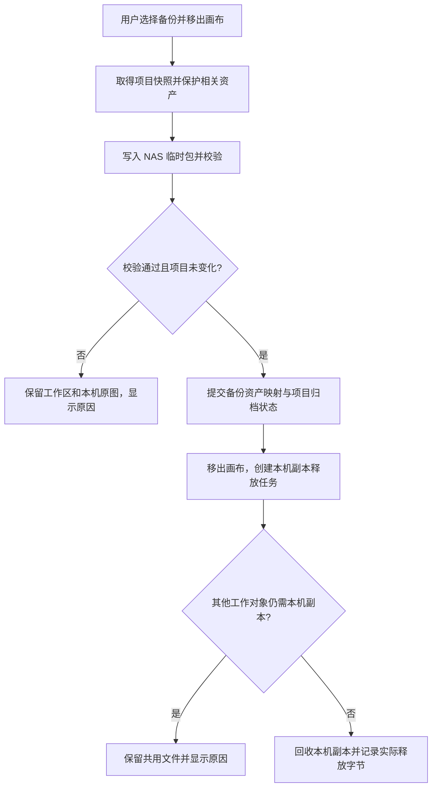

# 图片存储与删除生命周期设计

日期：2026-11-15。状态：现状审计与建议方案，尚未实施。本文未删除真实文件，未修改数据库或安装应用。

## 1. 核心结论

当前问题来自缺少统一的资源生命周期：画布对象、原图文件、素材引用、回收站、缓存和 NAS 备份分别管理，删除入口使用不同规则。“从界面消失”“本机原图已删除”“NAS 仍可恢复”没有形成一致的状态与结果。

需要统一资源登记、明确用户操作语义、集中判断引用、用持久化任务回收文件，并展示保留原因及实际释放空间。不能简单把 `keepFiles=true` 改成 `false`，也不能把“扫描不到引用”当成“已安全备份”。

## 2. 官方产品与工程实践参考

以下页面本次已直接读取。产品行为来自官方说明；后续数据模型和任务设计是针对 AIStudio 的工程建议，不是这些产品内部实现的声明。

| 来源 | 已核实的行为 | AIStudio 可借鉴的原则 |
| --- | --- | --- |
| [Apple Photos 删除说明](https://support.apple.com/en-us/104967) | 删除后进入“最近删除”，保留 30 天；iCloud Photos 删除会传播到其他设备 | 明确恢复期、永久删除和同步影响范围 |
| [Google Drive 删除说明](https://support.google.com/drive/answer/2375102?hl=en) | 回收站文件仍占空间，30 天后永久删除 | 回收站占用应单独展示，明确到期时间 |
| [OneDrive 按需文件说明](https://support.microsoft.com/en-us/onedrive/save-disk-space-with-onedrive-files-on-demand-for-windows) | “释放空间”可使文件变为仅在线；“始终保留在此设备”维持离线副本 | 把释放本机副本与删除资产分开，明确离线可用性 |
| [restic 删除与回收说明](https://restic.readthedocs.io/en/stable/060_forget.html) | `forget` 移除快照，`prune` 回收只被已移除快照引用的数据 | 元数据删除与物理回收分阶段；共用内容要检查全部有效引用 |

Adobe Lightroom 官方页面本次访问返回 HTTP 403，未将其作为本次已核实的依据。30 天、24 小时等不是适用于所有软件的行业强制标准。

## 3. 当前代码中的问题

| 位置 | 已观察到的逻辑 | 影响 |
| --- | --- | --- |
| `src/app/page.tsx` 的 `deleteImage`、`src/lib/local-backend.ts` 的 `softDeleteImageRecord` | 普通作品删除只写 `deleted_at` | 支持恢复，但文件继续占空间；需要清楚告知 |
| `src/lib/local-backend.ts` 的 `hardDeleteTrashedBefore` | 有按时间清理函数；本次所查调用路径没有发现自动执行该策略的调度 | 不能把已有函数当成已实现的自动到期回收 |
| `src/lib/project-backup-service.ts` | 备份并移除项目调用 `clearLocalProjectArchiveData(..., true)` | 本机项目元数据移除，原文件仍保留；缺少逐资源释放凭据 |
| `src/components/ProjectArchiveCenter.tsx` | 备份请求传 `deleteAfterBackup: true` | “备份”与“归档移除”行为耦合；当前行为应保留为明确的归档选项 |
| `src/lib/storage-management.ts` 的 `references` | 读取目录内 JSON，用文件名或编码文件名的字符串包含关系判断引用 | 历史任务、日志或旧记录可能长期阻止回收；缺少保留原因；不能覆盖仅在浏览器中的引用 |
| `src/lib/local-backend.ts` 的 `isLocalFileKeyReferenced` | 检查部分业务表中的 key，与存储扫描的判断不同 | 同一文件在不同删除入口可能得到不同结论；URL、外部索引等需统一登记 |
| `src/app/api/trash/route.ts`、`src/app/api/history/route.ts` 的云端永久删除 | 引用保护范围不同；一些路径先删文件后删记录 | 共用资产保护不足，记录提交失败可能留下引用已丢失文件的记录；该云端路径本次未在线验证 |
| `src/lib/local-backend.ts` 的 `withDb` 与直接删除文件路径 | mutator 内可能先删文件，再写 JSON 数据库；底层删除错误有吞掉处理 | 数据提交失败时不能恢复已删文件；返回成功不等于字节已释放 |
| `src/lib/media-storage.ts` | 可同时读取当前目录和历史目录，按 key 返回找到的文件 | 需要登记每个物理副本，不能只删第一个匹配路径 |

现有措施中，扫描后的二次检查、文件指纹、24 小时新文件保护、索引损坏停止清理，以及 NAS 整包/资源 SHA-256 校验应保留并加强。

上一轮盘点的约 6.13 GiB 未引用旧文件，只说明按当前服务端 JSON 规则未匹配到引用。它不证明所有文件都已进入 NAS，也不证明浏览器中的案例、风格包、草稿或撤销历史不再需要它们。

## 4. 面向用户的操作语义

| 操作 | 工作区变化 | 本机文件处理 | NAS 处理 |
| --- | --- | --- | --- |
| 从画布删除作品 | 当前作品进入回收站，可撤销 | 恢复期内保留，其他使用处继续可用 | 历史备份保留 |
| 移除参考图/素材引用 | 只移除当前使用关系 | 最后一个有效引用消失后进入回收流程 | 历史备份保留 |
| 永久删除/清空回收站 | 当前回收站对象不可恢复 | 无其他有效引用才回收；共用文件显示保留原因 | 不级联删除历史备份 |
| 仅备份到 NAS | 项目继续留在工作区 | 保留 | 新增已校验的备份版本 |
| 备份到 NAS 并移出画布 | 保留项目备份卡片，移出工作列表 | 校验完成后，释放该项目独占、允许释放的本机文件 | 保留可恢复版本 |
| 释放本机副本 | 卡片标为“仅 NAS”，按需恢复 | 仅释放有有效备份凭据、且无其他本机使用者的副本 | 不删除备份 |
| 删除 NAS 备份版本 | 移除指定历史版本 | 不删除本机项目 | 单独删除指定版本；若它是已释放资源最后恢复来源，须明确告知并要求显式删除该最后副本 |

普通 Delete 保持现有“作品进入回收站”的习惯；“仅移出画布但保留图库作品”若需要，应是另一个明确动作。对生成图、参考图和导入图，操作结果都必须可解释。

当前用户已选择备份后移出画布的工作方式。改造时将它明确命名为“备份并移出画布”，不静默改回只备份，也不将它描述为已经释放空间。

建议新策略：回收站默认 30 天，可设 7/30/90 天或手动清理；这是产品建议，尚未启用。对已有回收站内容先显示清单与迁移规则，不因上线新策略立即删除历史文件。

用户“永久删除”表示删除当前作品记录及不再需要的工作副本；旧 NAS 快照可能仍包含图片，界面应说明。需要彻底清除所有历史副本时应提供独立、明确范围的操作，不隐式传播。

## 5. 资源数据模型

不要用单个“图片状态”混合业务生命周期、物理位置和备份状态。建议分开建模：

| 实体 | 最小字段与作用 |
| --- | --- |
| `assets` | `id, owner_id, sha256, size, mime_type, created_at`：内容身份；新内容新增不可变资产 |
| `asset_references` | `asset_id, owner_type, owner_id, project_id, purpose, expires_at`：谁正在使用、为什么保留 |
| `asset_copies` | `asset_id, storage_id, path, state, verified_at, fingerprint, last_access_at`：每个本机/外置目录物理副本 |
| `trash_entries` | `entity_type, entity_id, project_id, deleted_at, purge_after`：作品或项目的恢复窗口 |
| `backup_versions` | `id, repository_id, project_id, snapshot_hash, package_path, package_sha256, state, verified_at`：备份版本 |
| `backup_assets` | `backup_version_id, asset_id, archive_path, sha256, size`：文件实际包含于哪个包、包内路径与校验值 |
| `storage_jobs` | `id, kind, status, candidates, progress, reclaimed_bytes, errors, retry_at`：迁移、回收、校验任务与审计 |
| `asset_leases` | `asset_id, task_id, expires_at`：生成、编辑、导入、恢复、备份期间的临时保护 |

首期可沿用 JSON 数据库，通过主服务统一写入并加版本检查和持久化任务；不必为修复泄漏立即全量迁库。事务关系与任务规模扩大后，可将本机资产登记迁至 SQLite，远端模式使用 PostgreSQL。数据库迁移本身不代替引用完整性和文件回收设计。

若使用哈希去重，首期限定同一账号、同一存储域，比较大小与完整 SHA-256 后再合并内容，不跨账号静默合并。内容相同可以共享字节，作品、权限和删除记录仍独立。不要用引用计数作为唯一删除依据，最终回收前重新查询实际引用关系。

### 引用必须明确其意义

- 强引用：当前画布、图库、素材、字体作品、参考库、保留期内的回收站、需完整恢复的编辑版本，阻止回收最后可用副本。
- 临时租约：正在处理的任务、服务端已登记的未保存草稿、撤销窗口，防止“先落盘后提交记录”期间误删。任务完成后解绑；长期运行通过续租保护。
- 历史说明：日志、已结束任务中的 URL、生成参数来源、已释放附件的聊天记录，不无限期阻止回收；保留小缩略图或标记“原图已清理”。若聊天附件承诺完整重用，应登记为强引用或先归档，而不是靠字符串推断。
- 备份关系：证明能否释放本机副本；包内已有完整资产不必强制本机原图永久存在。

浏览器 localStorage 中的案例、风格包、草稿等先迁入服务端引用登记。迁移前未覆盖的内容必须在报告中列为未知项，不启用无人值守的历史原图清理。页面离线时使用已同步的草稿和租约保护；不能把关闭页面当成已不需要图片的证据。

## 6. 物理回收流程

所有删除入口只提交业务变更与回收意图，禁止各业务 API 自己直接 unlink/S3 删除。统一任务执行器负责物理文件，独立工作进程处理大文件和 NAS I/O，避免阻塞画布。

1. 同一次元数据提交中：移除或过期对应引用，生成待回收任务。业务记录已删除与物理回收完成使用不同状态。
2. 扫描标记候选：排除有效强引用、回收站、编辑历史、任务租约、未知格式及不归本应用管理的文件。新文件默认给予 24 小时兜底保护；租约未结束时即使超过 24 小时也不回收。
3. 在主服务的资源协调锁下重新读取引用、租约、索引版本、文件指纹和存储根身份。获取引用与回收使用同一协调机制，避免“检查后新增引用”的竞态。
4. 对正常永久删除，确认最后业务使用关系已结束；对释放本机副本，还须确认指定 NAS 仓库在线、身份一致、整包有效、该资产已在包内校验、项目快照未变化。NAS 路径存在或卡片显示成功都不足以证明。
5. 将副本标记为回收中；在受管理的同盘暂存区原子重命名，或使用可重试的存储删除步骤。新引用创建必须等待/取消该回收或先恢复可用副本。暂存区仍占空间，不能算已释放。
6. 删除成功并确认文件不存在后，提交物理副本删除结果；更新本机字节统计。失败记为待重试，返回具体原因；共享文件显示“作品已删除，文件被其他对象使用”。
7. 重启后恢复未结束任务，重新核对状态再执行。重复执行不得误删新文件；租约到期也应结合任务真实状态判断。

文件系统和数据库无法用一个普通事务同时提交，需要持久化任务与幂等恢复。存储目录迁移、恢复和 GC 必须共享协调规则；多个目录中的同一文件分别登记，不能只删读取函数找到的第一份。回收任务应按文件去重统计，并避免扫描与用户操作同时重复计数。

禁止扫描用户任意外部目录后自动删除来源原图；只管理应用拥有的副本。NAS 断连不得创建同名本机路径冒充挂载目录；索引损坏、仓库身份不符或缺少引用适配器时停止对应回收并可见地报错。

## 7. NAS 归档的正确完成条件

沿用已有工作进程、流式写入、`.part` 文件、整包与资源 SHA-256 校验、快照变更检测；新增本地资源与备份资产之间的持久化关系。

最终分别显示“NAS 备份已校验”“已移出画布”“本机释放 X MB / 共用保留 Y MB / 待处理 Z MB”。部分释放失败不应被一句“归档成功”掩盖。仅 NAS 状态仍需少量索引和缩略图，所以不承诺本机占用绝对为零。

NAS 离线时卡片可用缓存显示，但恢复须等待连接。删除 NAS 最后版本与本机释放任务协调，避免同时删除两份。备份版本保留策略独立配置，不因清空本机回收站而删 NAS；首期也不自动删除用户主动保存的历史版本。

## 8. 存储管理的展示

本机占用按物理文件互斥归类：正在使用的原文件、仅受回收站保护的文件、已备份可释放的副本、无人引用/待核实文件、预览缓存、临时文件；数据库/索引单列。活动使用优先于回收站保护，共用文件只统计一次；NAS 总量单独显示。未知文件不能混入可安全自动清理额度。

扫描结果除了大小，还要显示：来源项目/对象、保留原因、备份状态、到期时间、操作后可否恢复。预计释放字节按独占物理副本去重，执行后显示实际释放字节、保留与失败原因。

建议策略：缓存默认上限 256 MiB、按最近使用淘汰；任务临时文件在完成后及时清理，异常遗留仅在无有效任务/租约且超过保护期后处理；回收站按用户策略到期回收；孤儿历史文件在迁移审核完成前只报告。低空间提示引导清理，不自动删除活动作品或 NAS 历史。

## 9. 现有约 6 GiB 遗留文件的处理

1. 生成只读盘点：文件 key、路径、大小、完整哈希、各业务引用和备份覆盖，记录扫描时间；不复制整套应用或原图库。
2. 将 NAS 已校验包内的资产哈希与本机哈希比对，建立可追溯关系；同名、相同项目名、旧成功状态不能代替内容匹配。
3. 补齐服务端与浏览器引用。分为“已备份且无有效引用”“仍被使用”“未找到备份/未知”。
4. 输出可审阅的释放清单。仅在用户授权相应释放操作后，执行第一类；未知项保留。剩余未备份孤儿若用户确要删除，走独立明确的永久清理动作。
5. 回收后核对数据库和原图完整性，并从代表性 NAS 项目执行隔离恢复验证。清除本次验证的临时数据，保留简小报告；不累积应用或源码副本。

## 10. 分阶段实施与验收

第一阶段：统一所有删除入口与引用检查，持久化回收任务，补齐遗漏索引，修复“删文件先于写数据库”与吞错；调整按钮和结果文案；完成旧资源只读映射。新自动清理策略尚不作用于历史文件。

第二阶段：启用备份资产映射和“归档后释放本机”完整闭环；经过审核处理现有旧副本；明确共用文件、离线恢复与部分失败状态。

第三阶段：开启用户选定的回收站到期策略、租约保护下的孤儿回收、缓存淘汰与异常临时文件清理；再根据实际体量考虑去重、增量备份与索引迁库。

必须覆盖的验收场景：

- 删除作品后可在回收站恢复；恢复期限与空间展示一致。
- 同一原图被两个项目、案例、字体、参考库或聊天附件使用，删除其中一个不损坏其他对象。
- 普通回收站、存储管理、项目删除、素材移除、云端分支执行同一引用与回收规则。
- 归档后独占原图确实释放；共用原图保留并说明；NAS 包内容与恢复后的坐标、文字、原图哈希一致。
- NAS 断连、损坏、身份不符，备份中途修改项目时不释放工作副本。
- 长任务超过 24 小时、上传后索引尚未提交、未保存编辑/草稿与撤销窗口不误删。
- 扫描后新增引用、同时恢复、同时迁移目录、删除备份版本与释放本机并发时无文件丢失。
- 数据库提交失败、文件删除失败、文件重命名后崩溃、进程重启后的任务恢复可解释且可重试。
- 历史任务与日志不永久占住原图；旧浏览器资产未登记时不启用自动原图回收。
- 实际释放额度只计算删除成功的独占副本，多个对象引用同一文件不重复计算。

本文件只完成审计、公开资料核实和可实施设计。尚未运行新方案代码、修改真实数据、执行文件清理或在原生安装应用中验收。
